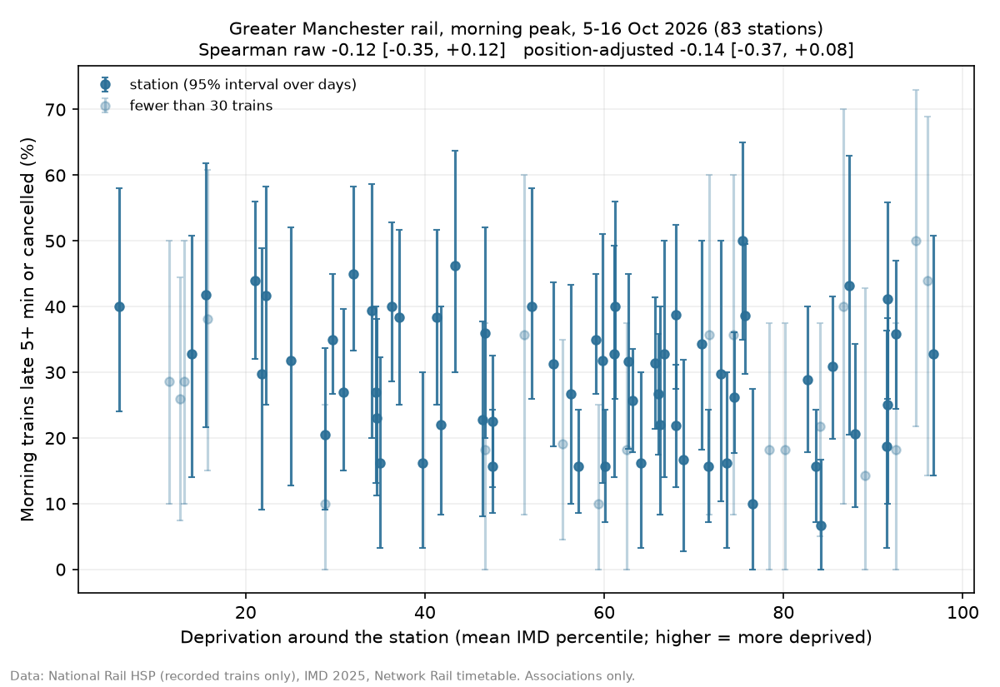

# ibmzDatathon
The repo for the IBM Z Datathon 2026.

## Setup

You need **Python 3.12** and Git. Use 3.12 specifically: it matches the LinuxONE VM, and the pinned numpy has no prebuilt Windows package for 3.13 or newer (pip then tries to compile it and fails). Having a newer Python installed as well is fine.

### 1. Install Python 3.12

Skip this step if `py -3.12 --version` (Windows) or `python3.12 --version` (macOS/Linux) already prints a version.

**Windows (PowerShell)**

```powershell
winget install Python.Python.3.12
```

Then close and reopen PowerShell so the new install is picked up. `py -0` should list `-3.12`.

**macOS (Homebrew)**

```bash
brew install python@3.12
```

**Ubuntu / Debian**

```bash
sudo apt update && sudo apt install -y python3.12 python3.12-venv
```

Or download the 3.12.x installer from https://www.python.org/downloads/.

### 2. Clone the repo

```bash
git clone https://github.com/Leoiskind/slahkers-ibmz-datathon-2026.git
cd slahkers-ibmz-datathon-2026
```

### 3. Create the virtual environment

Run this once, from the root of the repo.

**Windows (PowerShell)**

```powershell
py -3.12 -m venv .venv
.venv\Scripts\Activate.ps1
```

If PowerShell blocks the activate script, run this once and try again:

```powershell
Set-ExecutionPolicy -Scope CurrentUser RemoteSigned
```

**Windows (Command Prompt)**

```bat
py -3.12 -m venv .venv
.venv\Scripts\activate.bat
```

**macOS / Linux**

```bash
python3.12 -m venv .venv
source .venv/bin/activate
```

Your prompt should now start with `(.venv)`. Check that `python --version` prints 3.12.x.

### 4. Install the dependencies

```bash
python -m pip install --upgrade pip
python -m pip install -r requirements.txt
```

### 5. Check it works

```bash
python -c "import numpy, pandas, sklearn; print('OK')"
```

### 6. Set up your `.env` (API keys)

API keys and passwords live in a `.env` file in the root of the repo. It is gitignored, so it is never committed and never reaches GitHub. Copy the template:

**Windows (PowerShell)**

```powershell
Copy-Item .env.example .env
```

**macOS / Linux**

```bash
cp .env.example .env
```

Open `.env` and fill in the values you have. Leave the others blank:

| Key | What it is | Where to get it |
|---|---|---|
| `RTT_TOKEN` | Realtime Trains API bearer token | Sign up at https://api-portal.rtt.io/ |
| `HSP_URL`, `HSP_USERNAME`, `HSP_PASSWORD` | National Rail Historical Service Performance | The HSP product page on https://raildata.org.uk/ |

Rules for the file:

- Write one `KEY=value` per line, with no quotes and no spaces around `=`.
- Never paste a token into code, a notebook, a commit or a chat message.
- `src/config.py` reads `.env` automatically, so you don't need to `export` anything.

To check that your HSP settings load (it names any missing keys and never prints the values):

```bash
python -c "from src.config import hsp_credentials; hsp_credentials(); print('HSP settings OK')"
```

**On the LinuxONE VM:** `git pull` does not bring `.env` across, because it is gitignored. The teammate running the VM creates it there once, in `~/shared/slahkers-ibmz-datathon-2026/.env`. That folder is the same as `/home/jovyan/shared/slahkers-ibmz-datathon-2026/.env` inside the container.

### Everyday use

- Activate the environment every time you open a new terminal (the activate line from step 3).
- Leave it with `deactivate`.
- If you add a library, add it to `requirements.txt` with its version and tell the team.
- Never commit `.venv/`, datasets, models or secrets. They are already covered by `.gitignore`.

### Running on LinuxONE

See **[Running on IBM LinuxONE](#running-on-ibm-linuxone)** below.

## Results (5–16 October 2026, weekdays)

**No clear evidence of unequal service in this sample; here's a tool to keep checking, station by station.**

Main tests, fixed before seeing the data (morning peak, logistic regression, 83 Greater Manchester stations, 5,040 trains):

| Test | Spearman ρ | 95% interval (resampling stations) |
|---|---|---|
| Raw: deprivation vs failure rate | −0.12 | −0.35 to +0.12 |
| Position-adjusted: deprivation vs failure rate beyond what network position predicts | −0.14 | −0.37 to +0.08 |

Both intervals include zero. XGBoost (the robustness check) and the evening peak agree. For communication only: in the morning, 30% of trains failed at the most deprived third of stations and 32% at the least deprived third.



**Caveats:** results are associations, not causes. A train *fails* if it is 5+ minutes late or cancelled. Rates cover only trains recorded in National Rail's Historical Service Performance (HSP) data, about 72% of timetabled trains. Trains HSP did not record are left out rather than counted as cancelled, because a Realtime Trains check showed that most of them ran. The data covers 10 weekdays, and 9 October looks like a disruption day. Metrolink trams and buses are excluded. One station (SRN) has no deprivation score.

The per-station table is `data/processed/station_quality.csv`. IBM Granite drafts plain-English reports from these numbers; every draft is human-reviewed before use (see [`docs/ibmz_evidence/granite_area_morning_review.md`](docs/ibmz_evidence/granite_area_morning_review.md)).

## How to run (laptop)

```bash
python run_all.py
```

This runs geo → weather → journeys → models → evidence → briefs, with every stage cached. On a laptop the briefs stage only writes the prompts (dry run) unless `granite.model_path` is set.

Tests: `python tests/test_models_synthetic.py` (the pipeline recovers a planted effect on synthetic outcomes) and `python tests/test_brief.py` (the number check).

## Running on IBM LinuxONE

This is how we ran the project on the IBM LinuxONE Community Cloud VM (s390x, big-endian, 3 CPU cores, about 4 GB free RAM). Evidence from our run is in [`docs/ibmz_evidence/`](docs/ibmz_evidence/).

### 1. Connect and check the machine

```bash
ssh -i <your-key> ibm-user@<VM-IP>
uname -m                              # s390x
grep -o nnpa /proc/cpuinfo | head -1  # nnpa = the on-chip AI accelerator is available
```

### 2. Get the code

```bash
cd ~/shared
git clone https://github.com/Leoiskind/slahkers-ibmz-datathon-2026.git   # first time only
cd slahkers-ibmz-datathon-2026
git pull
```

Run every project command from this folder.

### 3. Use the IBM-provided Python environment

Use the Python environment that comes with the VM (the `venv`, or IBM's Jupyter Lab container). It already has TensorFlow with IBM's `ibm-zdnn-plugin`, XGBoost, scikit-learn and `llama-cpp-python`. Check:

```bash
python -c "import pandas, sklearn, scipy, joblib, yaml, xgboost, tensorflow as tf, llama_cpp; print('ok', tf.__version__)"
python -c "import importlib.metadata as m; print('zdnn', m.version('ibm-zdnn-plugin'))"
```

**`pyarrow` is not needed.** It has no s390x build. `src/tableio.py` writes every table as `.parquet` *and* `.csv` and reads the CSV copy when pyarrow is missing, so the VM runs entirely from the CSV files in `data/processed/`. Install anything else that's missing with `python -m pip install <name>`.

### 4. Get the Granite model (big-endian)

Models for s390x must be **big-endian** GGUF files. The VM ships only `granite-4.0-h-350m-base-be.f16.gguf`, a small *base* model that doesn't follow instructions reliably. We used Granite 3.3 2B Instruct, big-endian (about 1.55 GB), from the [s390x verified models](https://huggingface.co/taronaeo/Granite-3.3-2B-Instruct-BE-GGUF) collection:

```bash
cd /home/ibm-user
wget -c https://huggingface.co/taronaeo/Granite-3.3-2B-Instruct-BE-GGUF/resolve/main/granite-3.3-2b-instruct-be.Q4_K_M.gguf
head -c 4 granite-3.3-2b-instruct-be.Q4_K_M.gguf; echo     # should print GGUF
```

Point the project at it (this edit is machine-specific, so don't commit it):

```bash
cd ~/shared/slahkers-ibmz-datathon-2026
sed -i 's|^  model_path: .*|  model_path: "/home/ibm-user/granite-3.3-2b-instruct-be.Q4_K_M.gguf"|' config.yaml
grep -n -A1 "^granite" config.yaml
```

To pull later updates without losing this edit: `git stash && git pull && git stash pop`.

### 5. Run the analysis and the IBM Z model run

Run the stages one by one rather than `run_all.py` (see the note on Granite below):

```bash
python -m src.geo
python -m src.weather
python -m src.journeys
python -m src.models --peak both --profile ibmz
python -m src.evidence
```

`--profile ibmz` adds the Keras network, the NNPA check and an inference benchmark. Results go to `models/<version>/ibmz/{morning,evening}/metadata.json`. The logistic regression and XGBoost results should match a laptop run exactly. Ours did (morning ρ −0.12 raw, −0.14 adjusted).

### 6. Generate Granite reports (slow: about 12 minutes each)

On 3 CPU cores Granite 3.3 2B writes about 1 token per second, so **generate only the reports you need**, in the background:

```bash
nohup sh -c "python -m src.brief --level area && python -m src.brief --only GTO" > granite.log 2>&1 &
tail -5 granite.log
```

Don't run `python run_all.py --profile ibmz` with `granite.model_path` set unless you have hours to spare: it generates every report (area, boroughs and all stations, about 188), which takes more than a day at this speed.

**Human review is required.** The automatic check confirms every number came from the data, but not that the sentences are right. In our run Granite called 30% "higher than" 32%. Read every report in `data/processed/briefs/` and correct it before use.

### 7. Copy the evidence off the VM

`models/` is gitignored. Copy `models/<version>/ibmz/*/metadata.json` and `granite.log` into `docs/ibmz_evidence/` and commit them (`scp` from your laptop, Jupyter's file browser → Download, or `cat` and paste).

### What ran where on LinuxONE

| Part | Hardware |
|---|---|
| Keras network (benchmark only, not used for results) | CPU with IBM's zDNN plugin and the on-chip AI accelerator (NNPA) available: about 125,000 predictions per second |
| Logistic regression (main results), XGBoost (check) | CPU cores |
| IBM Granite 3.3 2B (report drafts) | CPU cores, about 1 token per second |

We didn't measure a CPU-only baseline, so we report speeds, not speed-ups.

### Troubleshooting

| Problem | Fix |
|---|---|
| `ModuleNotFoundError: pyarrow` | Make sure you have the latest code (`git pull`); it falls back to CSV automatically |
| `set granite.model_path in config.yaml` | Do step 4 |
| A Granite report is empty or flagged `needs_review` | Read it; it's a draft. Small *base* models (the 350M file) often fail, so use the 2B *Instruct* model |
| `Permission denied` writing files | `sudo chown -R $(id -u):$(id -g) ~/shared` |
| Out of memory | Don't run Granite and the model training at the same time; close other Jupyter kernels |

## Data sources

| Source | Used for | Licence / attribution |
|---|---|---|
| [Open-Meteo historical weather API](https://open-meteo.com/en/docs/historical-weather-api) | Hourly rain (mm) and wind (km/h) per GM station (`src/weather.py`) | [CC BY 4.0](https://open-meteo.com/en/license): weather data by Open-Meteo.com |
| [Network Rail SCHEDULE feed](https://wiki.openraildata.com/index.php/SCHEDULE) | Planned GM timetable (`src/timetable.py`) | [Open Government Licence](https://www.nationalarchives.gov.uk/doc/open-government-licence/version/3/), contains Network Rail data |
| [English Indices of Deprivation 2025](https://deprivation.communities.gov.uk/download-all) | IMD rank per LSOA (`src/geo.py`) | Open Government Licence |
| [National Rail Historical Service Performance (HSP)](https://wiki.openraildata.com/index.php?title=HSP) via the [Rail Data Marketplace](https://raildata.org.uk/) | Actual train times, lateness and cancellations, 5–16 Oct 2026 (`scripts/hsp_extract.py`, `src/journeys.py`) | Rail Data Marketplace licence terms |
| [ONS LSOA centroids](https://geoportal.statistics.gov.uk/) | LSOA → nearest station within 1.5 km (`data/processed/lsoa_station_matches.csv`) | Open Government Licence; contains OS data © Crown copyright |
| [Realtime Trains API](https://api-portal.rtt.io/) | Validation only: checked HSP lateness and cancellations for 5 Oct (`src/rtt.py`) | Realtime Trains API terms |

## Libraries

[pandas](https://pandas.pydata.org/) · [NumPy](https://numpy.org/) · [SciPy](https://scipy.org/) · [scikit-learn](https://scikit-learn.org/) · [XGBoost](https://xgboost.ai/) · [TensorFlow / Keras](https://www.tensorflow.org/) with [IBM zDNN plugin](https://pypi.org/project/ibm-zdnn-plugin/) · [matplotlib](https://matplotlib.org/) · [PyArrow](https://arrow.apache.org/docs/python/) (optional) · [PyYAML](https://pyyaml.org/) · [Requests](https://requests.readthedocs.io/) · [llama-cpp-python](https://github.com/abetlen/llama-cpp-python) · [IBM Granite 3.3 2B Instruct](https://huggingface.co/ibm-granite/granite-3.3-2b-instruct) (big-endian GGUF for s390x: [taronaeo/Granite-3.3-2B-Instruct-BE-GGUF](https://huggingface.co/taronaeo/Granite-3.3-2B-Instruct-BE-GGUF))
